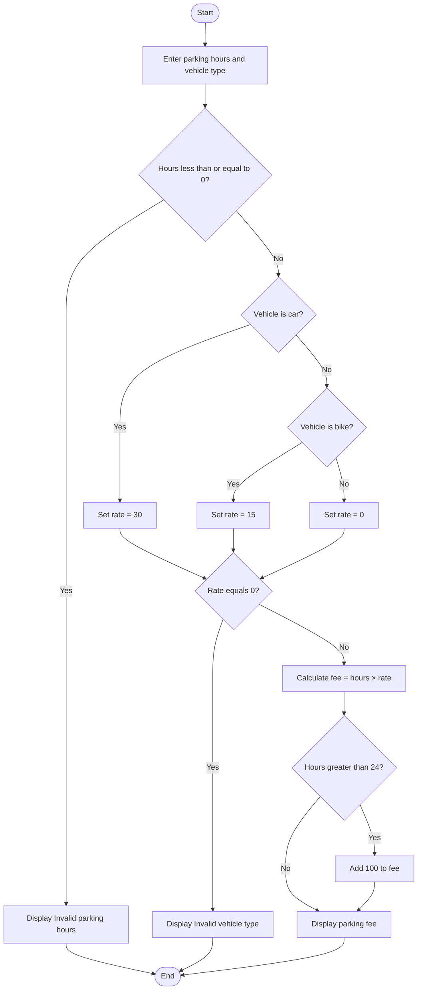

### Case Study 15: Smart Parking Fee Management

### 1\. Problem Statement

To calculate the parking fee based on parking hours and vehicle type. Cars are charged ₹30 per hour and bikes ₹15 per hour. An additional ₹100 is charged if parking exceeds 24 hours.

### 2\. Algorithm

* Read parking hours and vehicle type.

* If hours are less than or equal to zero, display “Invalid parking hours”.

* If the vehicle is a car, set the rate to ₹30.

* If the vehicle is a bike, set the rate to ₹15.

* If the vehicle type is invalid, display an error message.

* Calculate the fee by multiplying hours by the rate.

* If parking exceeds 24 hours, add ₹100.

* Display the final parking fee.

### 3\. Flowchart



### 4\. Python Source Code

```python

hours = float(input("Enter parking hours: "))
vehicle = input("Enter vehicle type (car/bike): ").lower()

if hours <= 0:
    print("Invalid parking hours")
else:
    if vehicle == "car":
        rate = 30
    elif vehicle == "bike":
        rate = 15
    else:
        rate = 0

    if rate == 0:
        print("Invalid vehicle type")
    else:
        fee = hours * rate

        if hours > 24:
            fee += 100

        print("Parking fee:", fee)
```

### 5\. Sample Input

```text
Enter parking hours: 25
Enter vehicle type (car/bike): car
```

### 6\. Sample Output

```text
Parking fee: 850.0
```

### 7\. Explanation

* Parking hours = 25

* Vehicle type = car

* Car rate = ₹30 per hour

* Basic fee = 25 × 30 = ₹750

* Extra charge = ₹100 because parking exceeds 24 hours.

* Final fee = ₹750 + ₹100 = ₹850.

Remember: Calculate the hourly fee first, then add ₹100 only when parking hours are greater than 24.
