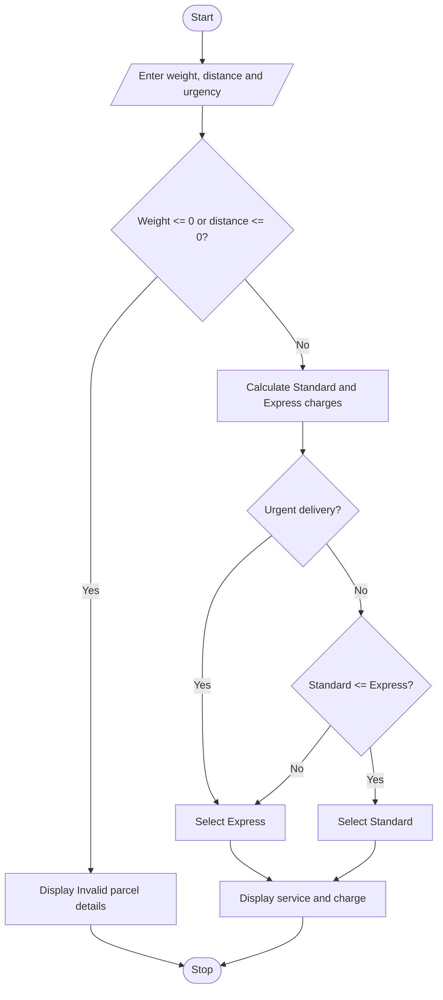

### Case Study 24: Courier Charge Optimization

### 1\. Problem Statement

To calculate courier charges based on parcel weight and distance. The program selects Express delivery for urgent parcels and the cheaper service for non-urgent parcels.

### 2\. Algorithm

* Start.

* Read parcel weight, distance, and urgency.

* Check whether weight and distance are greater than zero.

* If invalid, display an error message.

* Calculate Standard and Express charges.

* If delivery is urgent, select Express.

* Otherwise, select the cheaper service.

* Display the selected service and courier charge.

* Stop.

### 3\. Flowchart



### 4\. Python Source Code

```python

weight = float(input("Enter parcel weight in kg: "))
distance = float(input("Enter distance in km: "))
urgent = input("Urgent delivery? (yes/no): ").lower()

if weight <= 0 or distance <= 0:
    print("Invalid parcel details")
else:
    standard = 50 + weight * 10 + distance * 2
    express = 100 + weight * 15 + distance * 3

    if urgent == "yes":
        print("Selected service: Express")
        print("Courier charge:", express)
    else:
        if standard <= express:
            print("Selected service: Standard")
            print("Courier charge:", standard)
        else:
            print("Selected service: Express")
            print("Courier charge:", express)
```

### 5\. Sample Input

```text
Enter parcel weight in kg: 5
Enter distance in km: 10
Urgent delivery? (yes/no): no
```

### 6\. Sample Output

```text

Selected service: Standard
Courier charge: 120.0
```

### 7\. Explanation

* The program accepts the parcel weight, distance, and urgency.

* It checks whether the weight and distance are valid.

* Standard charge = 50 + (5 × 10) + (10 × 2) = ₹120.

* Express charge = 100 + (5 × 15) + (10 × 3) = ₹205.

* Since delivery is not urgent, the program selects Standard because it is cheaper.
