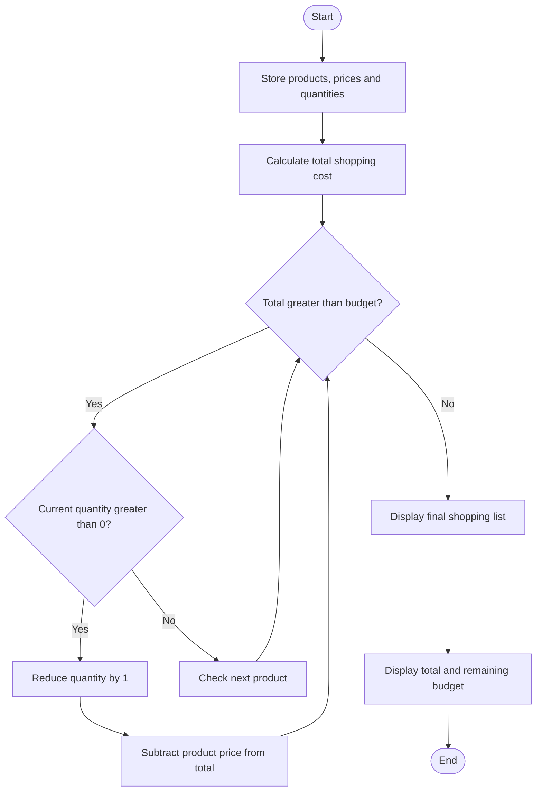

### Case Study 19: Multi-Product Shopping Budget Constraint

### 1\. Problem Statement

To calculate the total cost of multiple products and adjust their quantities to fit within a given budget. Display the final shopping list and remaining budget.

### 2\. Algorithm

* Store product names, prices, and quantities.

* Set the shopping budget to ₹2,500.

* Calculate the cost of each product and the total cost.

* If the total exceeds the budget, reduce product quantities one by one.

* Continue until the total cost is within the budget or all quantities become zero.

* Display the final shopping list, total cost, and remaining budget.

### 3\. Flowchart



### 4\. Python Source Code

```python

products = ["Shirt", "Shoes", "Bag"]
prices = [500, 1500, 800]
quantities = [2, 1, 2]
budget = 2500

total = 0

for i in range(len(products)):
    cost = prices[i] * quantities[i]
    total += cost
    print(products[i], "Cost:", cost)

print("Total cost:", total)

for i in range(len(products)):
    while total > budget and quantities[i] > 0:
        quantities[i] -= 1
        total -= prices[i]

print("\nFinal shopping list:")

for i in range(len(products)):
    print(products[i], "Quantity:", quantities[i])

print("Final total:", total)
print("Remaining budget:", budget - total)
```

### 5\. Sample Input

The program uses these predefined values:

```text
Products = Shirt, Shoes, Bag
Prices = [500, 1500, 800]
Quantities = [2, 1, 2]
Budget = ₹2500
```

### 6\. Sample Output

```text

Shirt Cost: 1000
Shoes Cost: 1500
Bag Cost: 1600
Total cost: 4100

Final shopping list:
Shirt Quantity: 0
Shoes Quantity: 1
Bag Quantity: 1
Final total: 2300
Remaining budget: 200
```

### 7\. Explanation

* Shirt: 500 × 2 = ₹1,000.

* Shoes: 1,500 × 1 = ₹1,500.

* Bag: 800 × 2 = ₹1,600.

* Initial total = ₹1,000 + ₹1,500 + ₹1,600 = ₹4,100.

* Since ₹4,100 exceeds the budget, the program reduces quantities.

* Final total = ₹1,500 + ₹800 = ₹2,300.

* Remaining budget = ₹2,500 − ₹2,300 = ₹200.
