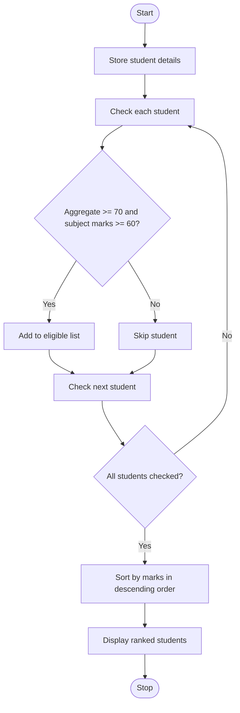

### Case Study 20: University Admission Decision Engine

### 1\. Problem Statement

To check which students are eligible for university admission based on their aggregate and subject marks, and rank eligible students from highest to lowest marks.

### 2\. Algorithm

* Start.

* Store student names, aggregate marks, and subject marks.

* Create an empty list for eligible students.

* Check whether aggregate marks are at least 70 and subject marks are at least 60.

* Add eligible students to the list.

* Sort students by aggregate marks and then subject marks in descending order.

* Display the ranked list.

* Stop.

### 3\. Flowchart



### 4\. Python Source Code

```python

students = [
    ("A", 85, 80),
    ("B", 75, 70),
    ("C", 90, 90),
    ("D", 60, 65)
]

eligible = []

for name, aggregate, subject_marks in students:
    if aggregate >= 70 and subject_marks >= 60:
        eligible.append((name, aggregate, subject_marks))

eligible.sort(key=lambda x: (x[1], x[2]), reverse=True)

print("Eligible Students Ranked:")

rank = 1
for name, aggregate, subject_marks in eligible:
    print(rank, name, aggregate, subject_marks)
    rank += 1
```

### 5\. Sample Input

The student details are already given in the program.

* Student A: Aggregate 85, Subject 80

* Student B: Aggregate 75, Subject 70

* Student C: Aggregate 90, Subject 90

* Student D: Aggregate 60, Subject 65

### 6\. Sample Output

```text

Eligible Students Ranked:
1 C 90 90
2 A 85 80
3 B 75 70
```

### 7\. Explanation

* The program checks each student's marks.

* A student is eligible if aggregate marks are at least 70 and subject marks are at least 60.

* Student D is not eligible because their aggregate is 60.

* The eligible students are sorted from highest to lowest aggregate marks.

* Student C gets rank 1, Student A gets rank 2, and Student B gets rank 3.
