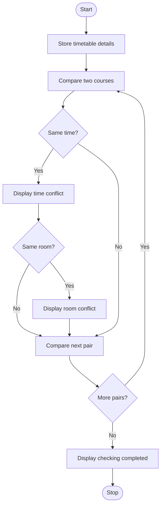

### Case Study 23: Student Timetable Conflict Detection

### 1\. Problem Statement

To check a student's timetable for time conflicts and room conflicts. If two courses have the same time, the program displays a time conflict. If they also have the same room, it displays a room conflict.

### 2\. Algorithm

* Start.

* Store the course names, timings, and room numbers.

* Compare each course with the remaining courses.

* Check whether two courses have the same time.

* If the times match, display a time conflict.

* If their rooms also match, display a room conflict.

* Display the completion message.

* Stop.

### 3\. Flowchart



### 4\. Python Source Code

```python

timetable = [
    ("Python", "9-10", "Room A"),
    ("Maths", "10-11", "Room B"),
    ("English", "9-10", "Room A"),
    ("Physics", "11-12", "Room C")
]

for i in range(len(timetable)):
    for j in range(i + 1, len(timetable)):
        course1, time1, room1 = timetable[i]
        course2, time2, room2 = timetable[j]

        if time1 == time2:
            print("Time conflict:", course1, "and", course2)

            if room1 == room2:
                print("Room conflict:", room1)

print("Timetable checking completed")
```

### 5\. Sample Input

The timetable details are already given in the program:

* Python — 9–10 — Room A

* Maths — 10–11 — Room B

* English — 9–10 — Room A

* Physics — 11–12 — Room C

### 6\. Sample Output

```text

Time conflict: Python and English
Room conflict: Room A
Timetable checking completed
```

### 7\. Explanation

* The program compares each course with the other courses.

* Python and English have the same time, 9–10, so a time conflict is displayed.

* Both courses are scheduled in Room A, so a room conflict is also displayed.

* The other courses do not have matching time slots.

* Finally, the program displays that timetable checking is completed.
